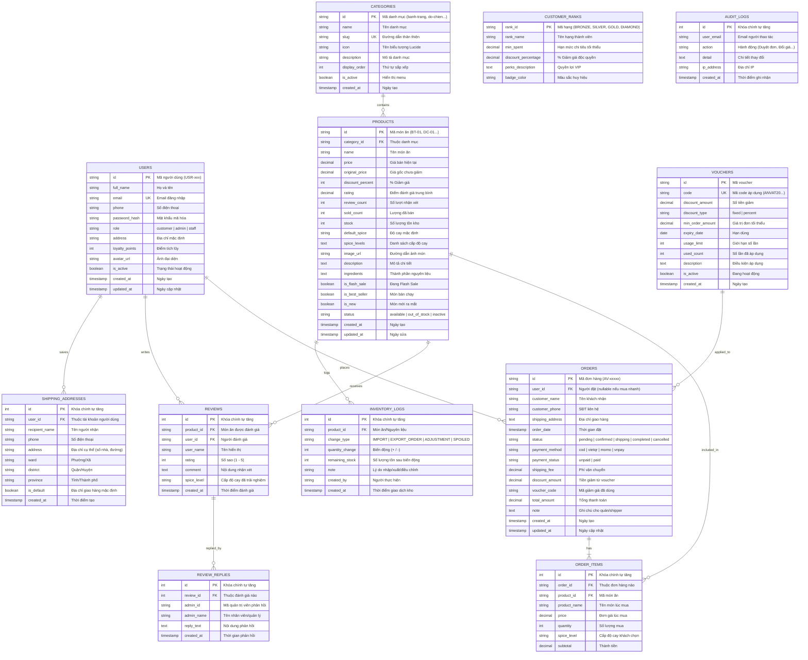

# SƠ ĐỒ THỰC THỂ QUAN HỆ (ERD) - WEBSITE ĐỒ ĂN VẶT

Tài liệu thiết kế cơ sở dữ liệu cho môn học Công nghệ phần mềm: Hệ thống Website Đặt Đồ Ăn Vặt Trực Tuyến (**ĂnVặtPro**).

## 1. Sơ đồ Mermaid ERD (12 Bảng Chuẩn Hóa)

## 2. Bảng tổng hợp quan hệ (Relationships)

| Bảng nguồn | Quan hệ | Bảng đích | Mô tả |
| :--- | :---: | :--- | :--- |
| `categories` | 1 - N | `products` | Một danh mục chứa nhiều sản phẩm món ăn vặt |
| `users` | 1 - N | `orders` | Một khách hàng có thể đặt nhiều đơn hàng |
| `orders` | 1 - N | `order_items` | Một đơn hàng bao gồm một hoặc nhiều món chi tiết |
| `products` | 1 - N | `order_items` | Một món ăn có thể xuất hiện trong nhiều chi tiết đơn hàng |
| `products` | 1 - N | `reviews` | Một món ăn nhận được nhiều lượt đánh giá từ khách |
| `users` | 1 - N | `reviews` | Một người dùng có thể gửi đánh giá cho sản phẩm |
| `reviews` | 1 - N | `review_replies` | Một đánh giá có thể được Admin/Chủ quán phản hồi giải đáp |
| `users` | 1 - N | `shipping_addresses` | Một người dùng có thể lưu nhiều địa chỉ nhận hàng trong sổ địa chỉ |
| `products` | 1 - N | `inventory_logs` | Mỗi sản phẩm có lịch sử ghi vết xuất/nhập/tồn kho chi tiết |
| `vouchers` | 1 - N | `orders` | Một mã voucher có thể được áp dụng cho nhiều đơn hàng hợp lệ |
